# Agent Office

**Watch Claude and its helper agents work in a small animated office.**

A mod for [Claude Code](https://code.claude.com). When Claude splits a task across helper agents, each one walks in through the door, sits down at its own desk and works there. An icon shows what it's doing, it raises a hand when it needs your approval, and it walks out with a green check when it's done.



## Install

In Claude Code, run:

```
/plugin install agent-office --marketplace Naumansaf/agent-office
```

Or from your terminal:

```bash
claude plugin install agent-office --marketplace Naumansaf/agent-office
```

Then restart Claude Code, or run `/reload-plugins` in an open session. Run `/plugin` to check: it should list agent-office as an active mod.

**Requirements:** Claude Code v2.1.287 or later (run `claude --version` to check, and `claude update` to upgrade).

## Use it

- Run `/office` to open the office, or
- click **watch** on the line above the prompt. That line appears whenever helper agents are around.

In the **Claude Desktop app** (Code tab) you get the illustrated office plus a live list of every agent. In the **terminal** you get the live list.

Helpers appear on their own whenever Claude uses helper agents for a task. There's nothing to set up: each one gets a name tag based on the job Claude gives it.

## What you'll see

| Moment | In the office |
| --- | --- |
| Claude hands out work | A new helper walks in through the door and sits at a free desk |
| A helper works | It stays at its desk, with an icon above it and its screen's light on its face |
| It needs your approval | It raises its hand with a **?** |
| It finishes | It gets a green check, stands up and walks out the door |
| It fails | It stays at its desk with a red **!** until you clear it |

The icons:

| Icon | Doing |
| --- | --- |
| Pencil | Editing files |
| Terminal ( >_ ) | Running a command |
| Globe | Researching online |
| Document | Reading or searching files |
| Plug | Using a connected app |
| Checklist | Planning, or handing out work |
| Three dots | Thinking |

Claude itself sits at the desk by the window. The room reacts too: the server rack blinks faster while commands run, the whiteboard fills in while Claude plans, the window follows your time of day, and the wall clock shows the real time.

## Cost and privacy

**None.** Agent Office only watches Claude Code's events on your machine and draws them. It makes no model calls and no network requests, and it never changes your prompts, tool calls or results, so it can't slow Claude down or use your plan limits.

## Where it works

- Claude Code in the terminal, and the Code tab of the Claude Desktop app, on sessions running on your computer.
- Not in regular Claude chats, Claude Cowork, or cloud sessions, which don't run Claude Code mods.
- If you use Claude Code through an organization, an administrator can limit which mods load.

## Update or remove

```bash
claude plugin update agent-office
claude plugin uninstall agent-office
```

## License

MIT. Made by Nauman Safdar.
